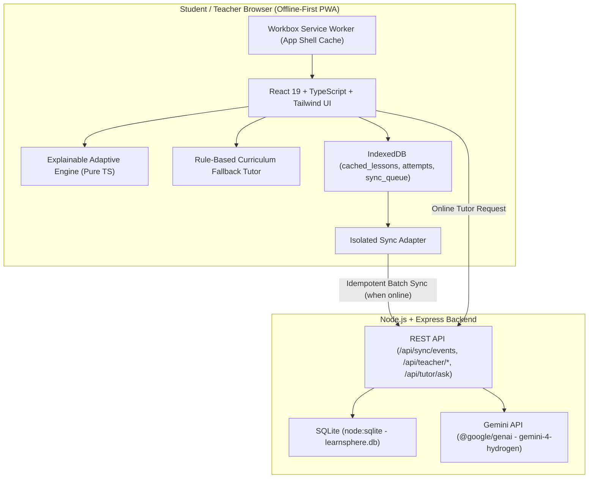

# LearnSphere AI — Learn Anywhere. Grow Everywhere.

**Track:** UnlockED – Unlocking Educational Potential, Empowering Futures (wHACKiest 2026)  
**Problem Statement:** Low-Bandwidth Adaptive Learning for Rural Schools

LearnSphere AI is an offline-first, explainable adaptive learning ecosystem designed for rural school students, low-cost devices, and teachers managing multi-level classrooms under intermittent internet connectivity.

---

## 1. The Real-World Problem

Students in rural and underserved schools face two tightly coupled barriers:
1. **Unreliable Connectivity:** Conventional digital learning platforms assume uninterrupted high-speed internet. When mobile data drops, video lessons stall, quizzes fail to submit, and learner progress disappears.
2. **One-Size-Fits-All Content:** When a student repeatedly struggles with a foundational topic (such as Fractions or Plant Transport), static platforms deliver the exact same material to every student without targeted explanations or difficulty adjustment.

Addressing connectivity without adaptation leaves struggling learners behind; building adaptation that requires constant cloud connectivity excludes rural students. LearnSphere AI solves both together.

---

## 2. Proposed Solution & Core Innovation

**The LearnSphere Learning Loop:**  
`ASSESS → UNDERSTAND → ADAPT → LEARN → PRACTISE → SAVE OFFLINE → SYNC → IMPROVE`

1. **Continuity-First PWA + IndexedDB:** Essential application assets are precached by a Workbox Service Worker, and lessons, quiz attempts, and sync events are persisted locally in IndexedDB.
2. **Explainable Adaptive Engine:** Every recommendation displays the exact formula inputs (recent accuracy, cumulative accuracy, difficulty weighting, and repeat-error penalty) in plain language.
3. **Resilient Event-Based Sync:** Offline actions enqueue timestamped `SyncEvent` payloads with unique `eventId` keys. Reconnection flushes the queue to an idempotent backend endpoint (`POST /api/sync/events`) with duplicate prevention.
4. **Bilingual Accessibility & Dual-Mode Tutor:** Full English and Kannada (`ಕನ್ನಡ`) UI and sample curriculum, adjustable text size, browser read-aloud support, and a server-side Gemini AI tutor with a transparent rule-based local fallback when offline or unconfigured.

---

## 3. System Architecture



---

## 4. End-to-End Student & Teacher User Flow


---

## 5. How the Explainable Adaptive Engine Works

Implemented in `src/domain/adaptiveEngine.ts` as a transparent, deterministic pedagogical algorithm (intentionally **not** presented as a trained ML model):

```
rawScore = (0.50 * recentAccuracy)
         + (0.30 * cumulativeAccuracy)
         + (0.20 * difficultyWeightedAccuracy)
repeatPenalty = min(15, effectiveRepeatWrongCount * 5)
masteryScore  = clamp(round(rawScore - repeatPenalty), 0, 100)
```

- **Difficulty Weights:** `beginner = 1.0`, `intermediate = 1.2`, `advanced = 1.4`.
- **Mastery Thresholds:**
  - `< 55%` (`weak`): Recommends foundational lesson + `beginner` practice.
  - `55% – 74%` (`developing`): Recommends revision + `intermediate` practice.
  - `75% – 84%` (`proficient`): Recommends `advanced` challenge practice.
  - `>= 85%` (`mastered`): Excluded from remedial recommendations so students move forward.
- **Documented Limitations:** Relies on MCQ accuracy rather than open-ended step work, assumes equal topic granularity across subjects, and should be calibrated with teacher judgement in classroom pilots.

---

## 6. How Offline-First Persistence & Sync Work

1. **App Shell Caching:** `vite-plugin-pwa` generates a Service Worker precaching JS, CSS, HTML, fonts, and generated illustrations.
2. **Structured Local Data (`src/storage/offlineDb.ts`):** Uses `idb` to store downloaded lessons (`cached_lessons`), quiz results (`attempts`), student profile (`meta`), and pending sync events (`sync_queue`).
3. **Idempotent Sync (`src/storage/syncAdapter.ts` & `POST /api/sync/events`):**
   - Each quiz completion or progress update creates a `SyncEvent` with a unique `eventId` and ISO timestamp.
   - When offline (or when **Simulate Offline** is toggled), events stay in `sync_queue` across page reloads.
   - Upon reconnection, `flushSyncQueue` sends pending events in a batch. The server verifies `event_id` uniqueness in SQLite `sync_events`, skipping duplicates safely.

---

## 7. AI Tutor Integration & Transparent Fallback

- **Online with `GEMINI_API_KEY`:** `POST /api/tutor/ask` calls `@google/genai` (`gemini-4-hydrogen`) strictly on the server—no keys ever reach the client bundle.
- **Offline or No API Key:** `src/domain/fallbackTutor.ts` responds using local curriculum explanations, worked examples, and practice questions in English or Kannada.
- **Honest Attribution:** Every message clearly displays whether it came from **Gemini AI** or the **Local Rule-Based Fallback Tutor**.

---

## 8. Folder Structure

```
├── server.ts                  # Express + Vite + SQLite REST API entry point
├── src/
│   ├── domain/                # Pure TypeScript logic & unit tests
│   │   ├── adaptiveEngine.ts  # Explainable mastery scoring & recommendations
│   │   ├── curriculum.ts      # Bilingual (EN/KN) sample lessons & question bank
│   │   ├── fallbackTutor.ts   # Local rule-based tutor
│   │   ├── syncLogic.ts       # Queue builder, deduplication, retry backoff
│   │   ├── i18n.ts            # English & Kannada translations
│   │   └── *.test.ts          # Node test runner unit tests
│   ├── storage/               # IndexedDB persistence & sync adapter
│   ├── server/                # SQLite schema/seed & server-side Gemini helper
│   ├── components/            # Landing, 3D globe, Student & Teacher UIs
│   └── hooks/                 # PWA install & browser connectivity hooks
├── public/                    # PWA icons (SVG + 192/512 PNGs + Apple Touch Icon)
└── presentation/              # 8-slide deck outline, pitches, demo script, Q&A
```

---

## 9. Running Locally & Testing

### Prerequisites
- Node.js `v22+` (uses built-in `node:sqlite`)

### Setup & Run
```bash
npm install
cp .env.example .env   # Optional: add GEMINI_API_KEY for live Gemini Tutor
npm run dev            # Runs Express + Vite dev server on http://localhost:3000
```

### Automated Tests & Checks
```bash
npm test               # Runs node:test unit tests for adaptive engine, sync logic, and fallback tutor
npm run lint           # TypeScript strict type-check (tsc --noEmit)
npm run build          # Production Vite bundle + PWA service worker generation
```

---

## 10. Demo Instructions

- **Demo Student (`Asha Kumari`, Grade 7):** Click **Start Learning** on the landing page. Starts with a clean slate so evaluators can run the full diagnostic → adaptive recommendation → offline download → offline quiz → reconnect & sync flow. Includes a **Reset Demo Data** button that only resets demo records.
- **Demo Teacher (`Meera Deshmukh`):** Click **Teacher View** to inspect class-wide weak topics, review seeded baseline classmates alongside Asha's synced progress, and publish targeted assignments.

---

## 11. Deployment

- **Full-Stack Deployment (Render, Railway, Fly.io, or Cloud Run):**
  1. Run `npm run build`
  2. Start with `NODE_ENV=production npm start` (`node server.ts`) on port `3000` (or `PORT`).
  3. Set `GEMINI_API_KEY` in hosting secrets if live Gemini Tutor responses are desired.
- **Static Frontend Only (e.g., Vercel):** The PWA shell, IndexedDB offline library, adaptive engine, and local fallback tutor work purely client-side, while `/api/sync/events`, `/api/teacher/*`, and `/api/tutor/ask` require deploying `server.ts` on a Node.js host (or setting `VITE_API_BASE` if split).

---

## 12. Known Limitations & Future Roadmap

**Current MVP Limitations:**
- Demo authentication uses role-based session tokens without real password accounts or OAuth (production requires school SSO / hashed credentials and HTTPS cookies).
- SQLite is single-node file storage (`learnsphere.db`); multi-school scale requires managed PostgreSQL or Firebase/Firestore with conflict resolution.
- Sample curriculum covers 9 core topics across Grades 6–8; production deployment needs state-board aligned content packs.

**Roadmap:**
- Peer-to-peer local classroom Wi-Fi/LAN sync hub for schools without cellular coverage.
- Offline compressed voice packs for Kannada and regional languages.
- Teacher CSV/PDF bulk report export and parent SMS weekly mastery digests.
